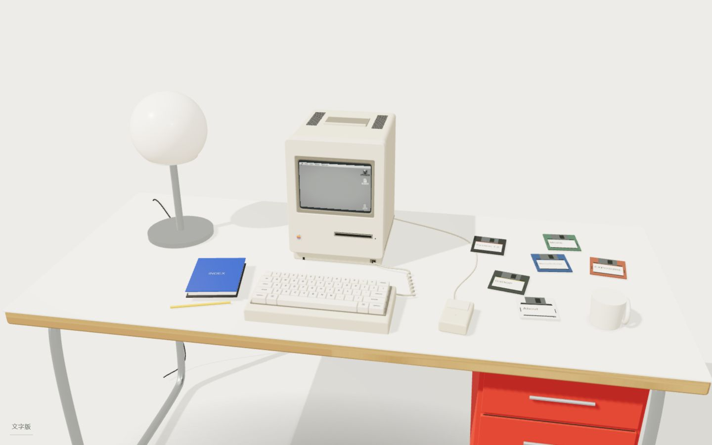
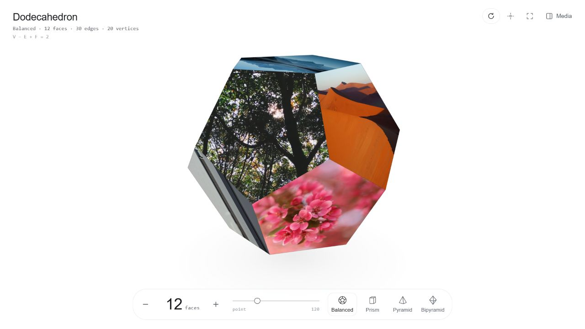
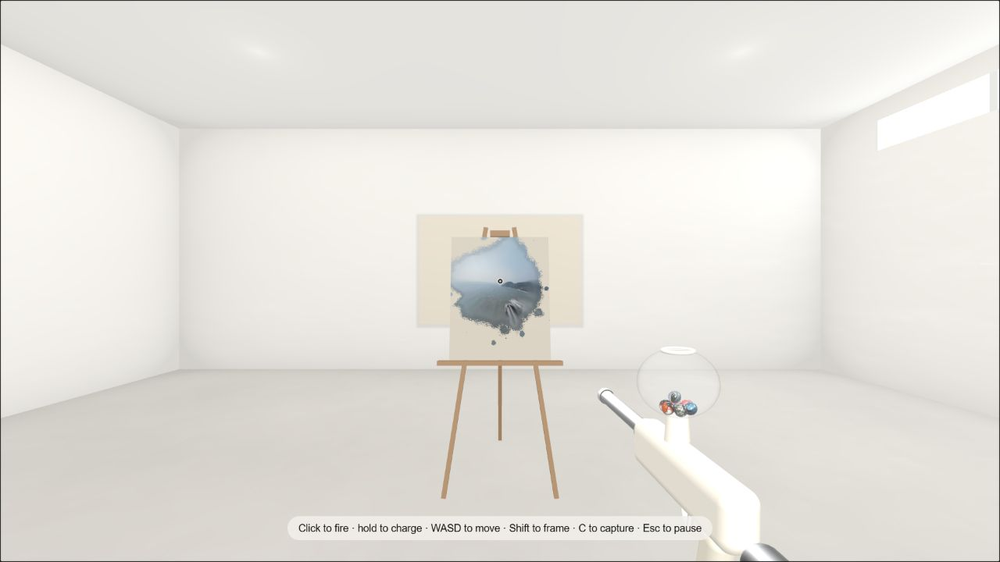

KAZE · SELECTED WORKS

# 把想法，做成可以体验的作品。

我是 kaze。喜欢琢磨界面、画面和操作之间的关系，做一些好看，也值得亲手玩一玩的东西。

[个人网站](https://zhaoye.org/)　 /　 [MORE](https://zhaoye.org/more/)　 /　 [EXPOSURE](https://zhaoye.org/exposure/)

 

## 01　ATELIER 84

### 从一张书桌开始。

我的个人网站是一张可以操作的书桌。挑一张软盘，放进 Macintosh，读一段介绍，再打开作品。把浏览个人主页，变成一次小小的探索。

**[坐到桌前 ↗](https://zhaoye.org/)**　·　[zhaoye.org](https://zhaoye.org/)

 

---

## 02　MORE

### 照片，也可以有很多面。

把照片和视频放到一个立体形状上。转一转、换个形状，从新的角度看熟悉的画面。喜欢的组合可以保存，也可以导出成一张图片。

**[转一转照片 ↗](https://zhaoye.org/more/)**　·　[zhaoye.org/more](https://zhaoye.org/more/)

 

---

## 03　EXPOSURE

### 用照片，留下一间属于你的房间。

走进一间白色房间，把照片投射到墙面和画布上。边走边看，让画面一点点留下痕迹，最后截一张图带走。

**[走进房间 ↗](https://zhaoye.org/exposure/)**　·　[zhaoye.org/exposure](https://zhaoye.org/exposure/)

 

---

建议使用电脑浏览，配合鼠标和键盘体验。

这里收录作品介绍、实际运行截图和体验入口。项目源码不包含在此仓库中。

